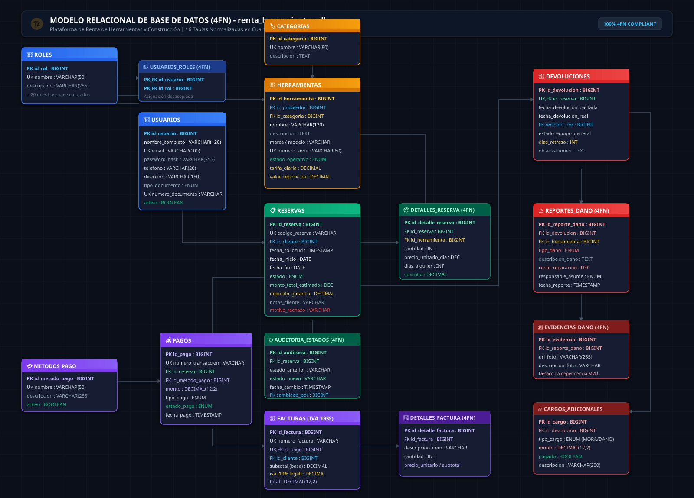

<div align="center">

# 🏗️ Plataforma de Renta de Herramientas y Equipos de Construcción 🚜

[](https://github.com/santiagoosorio0708e-wq/Proyecto_RentaHerramientas_OsorioDaniel_GarciaCamilo/stargazers)
[](https://github.com/santiagoosorio0708e-wq/Proyecto_RentaHerramientas_OsorioDaniel_GarciaCamilo/network/members)
[](https://github.com/santiagoosorio0708e-wq/Proyecto_RentaHerramientas_OsorioDaniel_GarciaCamilo/issues)
[](LICENSE)

<br/>

[](https://openjdk.org/)
[](https://spring.io/projects/spring-boot)
[](https://jwt.io/)
[-003B57?style=flat-square&logo=sqlite&logoColor=white)](https://www.sqlite.org/)
[-4479A1?style=flat-square&logo=mysql&logoColor=white)](https://www.mysql.com/)
[](http://localhost:8080/api/v1/swagger-ui.html)
[](https://junit.org/junit5/)
[](https://www.docker.com/)

<p align="center">
  <b>Ecosistema empresarial para la gestión integral de alquiler de maquinaria pesada, control de inventario en tiempo real, reservas con validación de disponibilidad, pasarela de pago simulada, facturación electrónica con 19% de IVA y check-in físico de retorno con inspección en Cuarta Forma Normal (4FN).</b>
</p>

---

</div>

<details open>
<summary><b>📑 Tabla de Contenidos (Click para desplegar / ocultar)</b></summary>

- [📖 Acerca del Proyecto](#-acerca-del-proyecto)
  - [🎯 Objetivos y Alcance](#-objetivos-y-alcance)
  - [👥 Perfiles de Usuario y Roles RBAC](#-perfiles-de-usuario-y-roles-rbac)
- [🛠️ Construido con](#️-construido-con)
- [🏛️ Arquitectura del Sistema](#️-arquitectura-del-sistema)
  - [📐 Estructura Hexagonal DDD por Bounded Context](#-estructura-hexagonal-ddd-por-bounded-context)
  - [🗄️ Modelo de Base de Datos y Normalización 4FN](#️-modelo-de-base-de-datos-y-normalización-4fn)
- [📋 Prerrequisitos](#-prerrequisitos)
- [🚀 Instalación y Puesta en Marcha](#-instalación-y-puesta-en-marcha)
  - [1. Clonar el Repositorio](#1-clonar-el-repositorio)
  - [2. Configuración de Base de Datos en MySQL](#2-configuración-de-base-de-datos-en-mysql)
  - [3. Ejemplo de Configuración `application.properties`](#3-ejemplo-de-configuración-applicationproperties)
  - [4. Compilación y Ejecución del Backend](#4-compilación-y-ejecución-del-backend)
  - [5. Acceso al Frontend Web y Swagger](#5-acceso-al-frontend-web-y-swagger)
  - [6. Despliegue con Docker y Docker Compose](#6-despliegue-con-docker-y-docker-compose)
  - [7. Despliegue en Apache Tomcat (WAR)](#7-despliegue-en-apache-tomcat-war)
- [💻 Uso y Características](#-uso-y-características)
  - [🔑 Autenticación y Seguridad JWT](#-autenticación-y-seguridad-jwt)
  - [📡 Catálogo de Endpoints con Ejemplos JSON](#-catálogo-de-endpoints-con-ejemplos-json)
- [🧪 Pruebas Automatizadas](#-pruebas-automatizadas)
- [📮 Pruebas con Postman](#-pruebas-con-postman)
- [🗺️ Hoja de Ruta (Roadmap)](#️-hoja-de-ruta-roadmap)
- [👥 Contacto y Autores](#-contacto-y-autores)

</details>

---

<a id="-acerca-del-proyecto"></a>
## 📖 Acerca del Proyecto

El alquiler de herramientas y maquinaria de construcción es un proceso crítico para contratistas, empresas de obras civiles y particulares. Tradicionalmente, la gestión de disponibilidad, contratos, cobros y el retorno de maquinaria sufre de desorganización y pérdidas por daños no documentados.

La **Plataforma de Renta de Herramientas y Equipos de Construcción** proporciona una solución tecnológica de grado productivo que digitaliza y automatiza el ciclo de vida completo: desde la publicación de inventario y la verificación de disponibilidad en calendario, hasta el pago en línea con emisión legal de factura tributaria (19% IVA) y la inspección técnica en devolución con registro forense de fotografías.

### 🎯 Objetivos y Alcance
* **Disponibilidad Concurrente:** Bloqueo automático de fechas para evitar colisiones de alquiler entre clientes.
* **Liquidación Fiscal Transparente:** Desglose automático de Base Gravable (Subtotal) e Impuesto al Valor Agregado (**IVA 19%**).
* **Inspección Técnica en 4FN:** Registro de averías categorizadas (`MECANICO`, `ELECTRICO`, `ESTETICO`, `IRREPARABLE`) respaldadas por evidencia fotográfica desacoplada.
* **Control de Mora Automatizado:** Liquidación de multas automáticas por días de retraso en la entrega física de la maquinaria.
* **Analítica Gerencial:** Tableros de control con KPIs financieros, tasa de siniestralidad y herramientas más rentables.

### 👥 Perfiles de Usuario y Roles RBAC

| Rol | Identificador Spring Security | Permisos y Alcance en la Plataforma |
|---|---|---|
| **Administrador** | `ROLE_ADMIN` | Control total del sistema: activar/bloquear usuarios, verificar documentos de proveedores, auditar alquileres globales, supervisar facturación y consultar el dashboard gerencial consolidado. |
| **Proveedor** | `ROLE_PROVEEDOR` | Registro y gestión de maquinaria/herramientas, configuración de tarifas diarias y valores de reposición, aprobación o rechazo de alquileres, y check-in físico de devoluciones con reporte de averías. |
| **Cliente** | `ROLE_CLIENTE` | Exploración del catálogo público con filtros dinámicos, solicitud de reservas seleccionando fechas, simulación de pago en pasarela electrónica, descarga de facturas y visualización de su historial. |

> **Credenciales de Demostración Preconfiguradas (Dataset Oficial):**
> * **Administrador:** `admin.perez@rentatool.com` | `Password123`
> * **Proveedor:** `ventas@maquiantioquia.com` | `Password123`
> * **Cliente:** `camilo.garcia@gmail.com` | `Password123`

[Volver al inicio ↑](#🏗️-plataforma-de-renta-de-herramientas-y-equipos-de-construcción-🚜)

---

<a id="️-construido-con"></a>
## 🛠️ Construido con

El backend y frontend han sido desarrollados con tecnologías modernas bajo estándares empresariales:

| Módulo / Capa | Tecnología | Versión | Rol en el Proyecto |
|---|---|---|---|
| **Lenguaje Core** | **Java** | **21 LTS** | Tipado estático robusto, Pattern Matching, Records y Virtual Threads. |
| **Framework Base** | **Spring Boot** | **3.4.1** | Núcleo de inyección de dependencias, API REST y configuración declarativa. |
| **Seguridad** | **Spring Security + JJWT** | **0.12.6** | Autenticación Stateless basada en JWT (Access + Refresh Token) y control RBAC. |
| **Persistencia** | **Spring Data JPA / Hibernate** | **6.6.4** | ORM, repositorios tipados, auditoría y consultas optimizadas. |
| **Base de Datos Core** | **SQLite 3 / MySQL** | **3.47+ / 8.0+** | SQLite por defecto (autónomo y portátil para Windows/macOS/Linux) y compatible con MySQL 4FN. |
| **BD de Pruebas** | **H2 / SQLite Disk** | **2.3+ / 3.47+** | Motor en memoria para tests ultrarrápidos y verificación física en disco. |
| **Documentación** | **Springdoc OpenAPI / Swagger UI** | **2.8.3** | Especificación OAS 3.0 interactiva para prueba y exploración de endpoints. |
| **Frontend** | **HTML5, CSS3 Moderno, JavaScript ES6+** | **Vanilla** | UI moderna, responsive (móvil/escritorio), modo día/noche y sin librerías pesadas. |
| **Contenedores** | **Docker & Docker Compose** | **24+** | Empaquetado reproducible multi-etapa y orquestación con MySQL 8. |
| **Servidor Web** | **Apache Tomcat Embebido / WAR** | **10.1** | Compatible tanto con ejecución autónoma (JAR) como despliegue externo (WAR). |

[Volver al inicio ↑](#🏗️-plataforma-de-renta-de-herramientas-y-equipos-de-construcción-🚜)

---

<a id="️-arquitectura-del-sistema"></a>
## 🏛️ Arquitectura del Sistema

El proyecto sigue una **Arquitectura Hexagonal (Ports and Adapters)** combinada con **Domain-Driven Design (DDD)**, estructurada en **Bounded Contexts (BC)** desacoplados para garantizar alta cohesión y bajo acoplamiento:

### 📐 Estructura Hexagonal DDD por Bounded Context

```text
c:\Users\osori\Desktop\proyecto-final-spring\
│
├── src/main/java/com/rentaherramientas/
│   │
│   ├── common/                                      # Infraestructura Transversal
│   │   ├── config/                                  # SecurityConfig, CorsConfig, OpenApiConfig
│   │   ├── dto/                                     # ApiResponseDto<T> estándar
│   │   └── exception/                               # GlobalExceptionHandler, BusinessException
│   │
│   ├── modules/                                     # Bounded Contexts de Negocio
│   │   ├── identidad/                               # BC 1: Usuarios, Roles y Seguridad JWT
│   │   │   ├── domain/                              # Modelos puros: Usuario, Rol, Credenciales
│   │   │   ├── application/                         # Casos de uso: AuthApplicationService
│   │   │   └── infrastructure/                      # AuthController, UsuarioController, Repositorios JPA
│   │   │
│   │   ├── inventario/                              # BC 2: Herramientas, Categorías y Tarifas
│   │   │   ├── domain/                              # Modelos: Herramienta, Categoria, Tarifa
│   │   │   ├── application/                         # Casos de uso: HerramientaApplicationService
│   │   │   └── infrastructure/                      # CatalogoController, HerramientaController
│   │   │
│   │   ├── reservas/                                # BC 3: Alquileres, Fechas y Disponibilidad
│   │   │   ├── domain/                              # Modelos: Reserva, DetalleReserva, RangoFechas
│   │   │   │   ├── ports/in/                        # CrearReservaUseCase, CambiarEstadoReservaUseCase
│   │   │   │   └── ports/out/                       # ReservaRepositoryPort, AuditoriaReservaPort
│   │   │   ├── application/                         # ReservaApplicationService
│   │   │   └── infrastructure/                      # ReservaController, ReservaPersistenceAdapter
│   │   │
│   │   ├── pagos/                                   # BC 4: Pasarela de Pagos y Facturación con IVA
│   │   │   ├── domain/                              # Modelos: Pago, Factura, DetalleFactura, MetodoPago
│   │   │   │   ├── ports/in/                        # ProcesarPagoUseCase, ConsultarFacturaUseCase
│   │   │   │   └── ports/out/                       # PagoRepositoryPort, FacturaRepositoryPort
│   │   │   ├── application/                         # PagoApplicationService (Cálculo 19% IVA)
│   │   │   └── infrastructure/                      # PagoController, FacturaController
│   │   │
│   │   ├── devoluciones/                            # BC 5: Check-in, Mora y Reporte de Daños 4FN
│   │   │   ├── domain/                              # Modelos: Devolucion, ReporteDano, EvidenciaDano
│   │   │   │   ├── ports/in/                        # RegistrarDevolucionUseCase, ReporteDanoUseCase
│   │   │   │   └── ports/out/                       # DevolucionRepositoryPort, CargosPort
│   │   │   ├── application/                         # DevolucionApplicationService (Liquidación Mora)
│   │   │   └── infrastructure/                      # DevolucionController, Adaptadores de Persistencia
│   │   │
│   │   └── reportes/                                # BC 6: Inteligencia de Negocio y Métricas
│   │       ├── domain/                              # Modelos: ResumenFinanciero, MetricasOperativas
│   │       │   ├── ports/in/                        # ConsultarReportesUseCase
│   │       │   └── ports/out/                       # ReporteRepositoryPort
│   │       ├── application/                         # ReporteApplicationService
│   │       └── infrastructure/                      # ReporteController, ReportePersistenceAdapter
│   │
│   ├── RentaHerramientasApplication.java            # Main Spring Boot
│   └── ServletInitializer.java                      # Soporte para despliegue Apache Tomcat (WAR)
│
├── database/                                        # Scripts DDL/DML (20 registros por tabla en 4FN)
├── docs/                                            # Documentación técnica y diagramas en imagen
├── frontend/                                        # UI Web (HTML, CSS y JavaScript Vanilla)
└── postman/                                         # Colecciones completas de pruebas de API
```

### 🗄️ Modelo de Base de Datos y Normalización 4FN

El esquema `renta_herramientas_db` está diseñado estrictamente en **Cuarta Forma Normal (4FN)**, eliminando anomalías de inserción, borrado y actualización:
* **Desacoplamiento de Dependencias Multivaluadas ($X \twoheadrightarrow Y \mid Z$):** Las fotografías forenses de daños están normalizadas en la tabla `evidencias_dano`, desacoplándolas de los atributos monetarios y técnicos del reporte de avería (`reportes_dano`).
* **Auditoría de Estados:** Los cambios de estado de las reservas se gestionan en `auditoria_estados_reserva`, permitiendo trazabilidad cronológica independiente de los ítems alquilados.
* **Desglose Tributario:** La tabla `detalles_factura` sustenta la base gravable y el impuesto discriminado legalmente.

#### 📊 Diagrama Relacional de la Base de Datos (Formato Imagen):


> **Verificación del Dataset:** El script [`database/data_20_records.sql`](database/data_20_records.sql) contiene **exactamente 20 registros poblados por cada una de las 16 entidades** del modelo.

[Volver al inicio ↑](#🏗️-plataforma-de-renta-de-herramientas-y-equipos-de-construcción-🚜)

---

<a id="-prerrequisitos"></a>
## 📋 Prerrequisitos

Para ejecutar la plataforma localmente se requiere:
* **Java Development Kit (JDK 21 LTS):** Verificar con `java -version` y `javac -version`.
* **MySQL Server 8.0+:** Servidor activo en el puerto 3306.
* **Git:** Para clonar el repositorio.
* *(Opcional)* **Docker & Docker Compose:** Si desea levantar el entorno en contenedores.
* *(Opcional)* **Navegador web moderno:** Google Chrome, Firefox, Safari o Microsoft Edge.

[Volver al inicio ↑](#🏗️-plataforma-de-renta-de-herramientas-y-equipos-de-construcción-🚜)

---

<a id="-instalación-y-puesta-en-marcha"></a>
## 🚀 Instalación y Puesta en Marcha

### 1. Clonar el Repositorio
```powershell
git clone https://github.com/santiagoosorio0708e-wq/Proyecto_RentaHerramientas_OsorioDaniel_GarciaCamilo.git
cd Proyecto_RentaHerramientas_OsorioDaniel_GarciaCamilo
```

### 2. Configuración de Base de Datos en MySQL
Cree la base de datos y cargue el esquema DDL y los registros de prueba (20 registros por tabla):
```powershell
mysql -u root -p -e "CREATE DATABASE IF NOT EXISTS renta_herramientas_db CHARACTER SET utf8mb4 COLLATE utf8mb4_unicode_ci;"
mysql -u root -p renta_herramientas_db < database\schema_4fn.sql
mysql -u root -p renta_herramientas_db < database\schema_identidad_inventario_4fn.sql
mysql -u root -p renta_herramientas_db < database\data_20_records.sql
mysql -u root -p renta_herramientas_db < database\data_identidad_inventario.sql
```

### 3. Ejemplo de Configuración `application.properties`
El archivo de configuración principal se encuentra en [`src/main/resources/application.properties`](src/main/resources/application.properties) y está diseñado bajo el principio de **cero claves hardcodeadas**, soportando variables de entorno con valores por defecto para desarrollo local:

```properties
spring.application.name=renta-herramientas

# Servidor y Context Path
server.port=${SERVER_PORT:8080}
server.servlet.context-path=/api/v1

# Conexión Base de Datos MySQL
spring.datasource.url=${DB_URL:jdbc:mysql://localhost:3306/renta_herramientas_db?useSSL=false&serverTimezone=UTC&allowPublicKeyRetrieval=true}
spring.datasource.username=${DB_USERNAME:root}
spring.datasource.password=${DB_PASSWORD:}
spring.datasource.driver-class-name=com.mysql.cj.jdbc.Driver

# Configuración JPA / Hibernate
spring.jpa.hibernate.ddl-auto=${JPA_DDL_AUTO:update}
spring.jpa.show-sql=false
spring.jpa.properties.hibernate.format_sql=true
spring.jpa.properties.hibernate.dialect=org.hibernate.dialect.MySQLDialect

# Seguridad y JWT (Clave HMAC-SHA256 de 256 bits)
jwt.secret=${JWT_SECRET:404E635266556A586E3272357538782F413F4428472B4B6250645367566B5970}
jwt.expiration-ms=${JWT_EXPIRATION_MS:86400000}
jwt.refresh-expiration-ms=${JWT_REFRESH_EXPIRATION_MS:604800000}

# CORS: orígenes autorizados del frontend
app.cors.allowed-origins=${APP_CORS_ALLOWED_ORIGINS:http://localhost:5500,http://127.0.0.1:5500,http://localhost:5173,http://localhost:3000,http://localhost:8080}

# Swagger / OpenAPI
springdoc.api-docs.path=/v3/api-docs
springdoc.swagger-ui.path=/swagger-ui.html
springdoc.swagger-ui.operations-sorter=alpha
springdoc.swagger-ui.tags-sorter=alpha
```

### 4. Compilación y Ejecución del Backend
Para compilar y correr el servidor embebido:
```powershell
# En Windows:
.\mvnw.cmd clean test
.\mvnw.cmd spring-boot:run

# En Linux / macOS:
./mvnw clean test
./mvnw spring-boot:run
```

### 5. Acceso al Frontend Web y Swagger
Una vez iniciado el backend:
* **Frontend Web (Servido automáticamente por Spring Boot):** [`http://localhost:8080/api/v1/index.html`](http://localhost:8080/api/v1/index.html) o [`http://localhost:8080/index.html`](http://localhost:8080/index.html)
* **Documentación Interactiva Swagger UI:** [`http://localhost:8080/api/v1/swagger-ui.html`](http://localhost:8080/api/v1/swagger-ui.html)
* **Especificación OpenAPI JSON:** [`http://localhost:8080/api/v1/v3/api-docs`](http://localhost:8080/api/v1/v3/api-docs)

> Si prefiere levantar el frontend en un servidor estático dedicado (por ejemplo Live Server de VS Code o Python en puerto 5500):
> ```powershell
> cd frontend
> python -m http.server 5500
> ```
> Y acceda a [`http://localhost:5500`](http://localhost:5500).

### 6. Despliegue con Docker y Docker Compose
Levanta la infraestructura multi-contenedor (MySQL 8 + Spring Boot 3.4):
```powershell
docker compose up --build -d
```
Para verificar logs y apagar:
```powershell
docker compose logs -f app
docker compose down
```

### 7. Despliegue en Apache Tomcat (WAR)
El proyecto incluye [`ServletInitializer.java`](src/main/java/com/rentaherramientas/ServletInitializer.java) que extiende `SpringBootServletInitializer`. Para empaquetar como WAR tradicional:
1. En `pom.xml`, configure `<packaging>war</packaging>`.
2. Ejecute `.\mvnw.cmd clean package -DskipTests`.
3. Copie el archivo `.war` resultante de `target/` a la carpeta `webapps/` de su servidor Apache Tomcat 10+.

[Volver al inicio ↑](#🏗️-plataforma-de-renta-de-herramientas-y-equipos-de-construcción-🚜)

---

<a id="-uso-y-características"></a>
## 💻 Uso y Características

### 🔑 Autenticación y Seguridad JWT
El sistema utiliza autenticación stateless basada en JSON Web Tokens (JJWT 0.12.6):
1. **Login:** El cliente envía sus credenciales a `POST /api/v1/auth/login`.
2. **Emisión de Tokens:** El backend responde con un `accessToken` (vigencia de 24h) y un `refreshToken` (vigencia de 7 días).
3. **Consumo de Rutas Protegidas:** Las peticiones subsiguientes envían el encabezado HTTP:  
   `Authorization: Bearer <accessToken>`
4. **Roles y Autorización:** Las operaciones críticas están restringidas mediante `@PreAuthorize("hasRole('ADMIN')")`, `@PreAuthorize("hasAnyRole('PROVEEDOR', 'ADMIN')")` o `@PreAuthorize("hasRole('CLIENTE')")`.

---

### 📡 Catálogo de Endpoints con Ejemplos JSON

#### 1. Módulo de Autenticación (`/auth`)

##### `POST /api/v1/auth/login` - Iniciar Sesión
* **Request JSON:**
```json
{
  "email": "camilo.garcia@gmail.com",
  "password": "Password123"
}
```
* **Response JSON (200 OK):**
```json
{
  "exito": true,
  "mensaje": "Inicio de sesion exitoso",
  "datos": {
    "accessToken": "eyJhbGciOiJIUzI1NiJ9.eyJzdWIiOiJjYW1pbG8uZ2FyY2lhQGdtYWlsLmNvbSIsImlkVXN1YXJpbyI6OSwicm9sZXMiOlsicm9sZXM6IFtST0xFX0NMSUVOVEVdIl19...",
    "refreshToken": "eyJhbGciOiJIUzI1NiJ9.eyJzdWIiOiJjYW1pbG8uZ2FyY2lhQGdtYWlsLmNvbSIsInRpXBvIjoicmVmcmVzaCJ9...",
    "idUsuario": 9,
    "nombreCompleto": "Juan Camilo Garcia",
    "email": "camilo.garcia@gmail.com",
    "roles": ["ROLE_CLIENTE"]
  }
}
```

##### `POST /api/v1/auth/registro/cliente` - Registro de Cliente
* **Request JSON:**
```json
{
  "nombreCompleto": "Esteban Morales",
  "email": "esteban.morales@constructora.com",
  "password": "Password123",
  "telefono": "3154448899",
  "direccion": "Calle 45 # 13-20, Medellín",
  "tipoDocumento": "CC",
  "numeroDocumento": "1025889900"
}
```

---

#### 2. Módulo de Catálogo e Inventario (`/catalogo`, `/herramientas`)

##### `GET /api/v1/catalogo` - Explorar Catálogo con Filtros
* **Query Params:** `?q=martillo&idCategoria=1&disponible=true`
* **Response JSON (200 OK):**
```json
{
  "exito": true,
  "mensaje": "Catálogo consultado exitosamente",
  "datos": {
    "content": [
      {
        "idHerramienta": 1,
        "nombre": "Rotomartillo SDS Max 1500W",
        "descripcion": "Martillo electroneumático para perforación profunda en concreto armado",
        "marca": "Bosch",
        "modelo": "GBH 8-45 D",
        "numeroSerie": "BOSCH-ROT-001",
        "estadoOperativo": "DISPONIBLE",
        "tarifaDiaria": 75000.00,
        "valorReposicion": 3200000.00,
        "nombreProveedor": "Constructora Equipos del Norte SAS",
        "nombreCategoria": "Perforación y Demolición"
      }
    ],
    "totalElements": 1,
    "totalPages": 1
  }
}
```

##### `POST /api/v1/herramientas` - Registrar Maquinaria (Proveedor)
* **Request JSON:**
```json
{
  "nombre": "Allanadora de Concreto 36 Pulgadas",
  "descripcion": "Motor a gasolina Honda GX160 de 5.5 HP para pulido de losas industriales",
  "marca": "Wacker Neuson",
  "modelo": "CT 36-5A",
  "numeroSerie": "WN-CT36-2026-99",
  "tarifaDiaria": 95000.00,
  "valorReposicion": 6800000.00,
  "idCategoriaPrincipal": 3
}
```

---

#### 3. Módulo de Reservas y Disponibilidad (`/reservas`)

##### `POST /api/v1/reservas` - Solicitar Reserva de Alquiler
* **Request JSON:**
```json
{
  "idCliente": 9,
  "fechaInicio": "2026-11-01",
  "fechaFin": "2026-11-05",
  "notasCliente": "Entrega en obra Torre 3 proyecto Fontibón",
  "depositoGarantia": 200000.00,
  "detalles": [
    {
      "idHerramienta": 1,
      "cantidad": 1,
      "precioUnitarioDia": 75000.00
    }
  ]
}
```
* **Response JSON (201 Created):**
```json
{
  "exito": true,
  "mensaje": "Reserva registrada con éxito",
  "datos": {
    "idReserva": 21,
    "codigoReserva": "RES-2026-0021",
    "idCliente": 9,
    "fechaInicio": "2026-11-01",
    "fechaFin": "2026-11-05",
    "estado": "SOLICITADA",
    "montoTotalEstimado": 300000.00,
    "depositoGarantia": 200000.00,
    "detalles": [
      {
        "idHerramienta": 1,
        "nombreHerramienta": "Rotomartillo SDS Max 1500W",
        "cantidad": 1,
        "diasAlquiler": 4,
        "precioUnitarioDia": 75000.00,
        "subtotal": 300000.00
      }
    ]
  }
}
```

##### `PATCH /api/v1/reservas/{id}/aprobar` - Aprobación del Proveedor
* **Response JSON (200 OK):**
```json
{
  "exito": true,
  "mensaje": "Reserva aprobada exitosamente",
  "datos": {
    "idReserva": 21,
    "codigoReserva": "RES-2026-0021",
    "estado": "APROBADA"
  }
}
```

---

#### 4. Módulo de Pagos y Facturación con IVA (`/pagos`, `/facturas`)

##### `POST /api/v1/pagos` - Procesar Pago y Emitir Factura Electrónica
* **Request JSON:**
```json
{
  "idReserva": 21,
  "idMetodoPago": 2,
  "monto": 300000.00,
  "tipoPago": "TOTALIDAD",
  "referenciaPasarela": "PSE-REF-89410294"
}
```
* **Response JSON (201 Created):**
```json
{
  "exito": true,
  "mensaje": "Pago aprobado y factura emitida con éxito",
  "datos": {
    "idPago": 21,
    "numeroTransaccion": "TXN-2026-0021",
    "idReserva": 21,
    "monto": 300000.00,
    "estadoPago": "APROBADO",
    "fechaPago": "2026-10-19T06:30:00",
    "facturaGenerada": {
      "idFactura": 21,
      "numeroFactura": "FAC-2026-0021",
      "subtotal": 252100.84,
      "iva": 47899.16,
      "total": 300000.00,
      "estadoFactura": "EMITIDA"
    }
  }
}
```

---

#### 5. Módulo de Devoluciones y Averías en 4FN (`/devoluciones`)

##### `POST /api/v1/devoluciones` - Check-In Físico de Retorno
* **Request JSON:**
```json
{
  "idReserva": 21,
  "fechaDevolucionReal": "2026-11-06",
  "idRecibidoPor": 1,
  "estadoEquipoGeneral": "BUENO",
  "observaciones": "Entrega con 1 día de retraso. Se liquida cargo por mora automático.",
  "reportesDano": []
}
```
* **Response JSON (201 Created):**
```json
{
  "exito": true,
  "mensaje": "Devolución registrada con éxito",
  "datos": {
    "idDevolucion": 21,
    "idReserva": 21,
    "diasRetraso": 1,
    "cargosAdicionales": [
      {
        "idCargo": 21,
        "tipoCargo": "MORA",
        "monto": 75000.00,
        "descripcion": "Penalización por 1 día de retraso en la entrega física"
      }
    ]
  }
}
```

##### `POST /api/v1/devoluciones/{idDevolucion}/danos` - Reporte de Avería con Evidencia 4FN
* **Request JSON:**
```json
{
  "idHerramienta": 1,
  "tipoDano": "MECANICO",
  "descripcionDano": "Falla en el percutor por sobrecalentamiento continuo sin refrigeración",
  "costoEstimadoReparacion": 180000.00,
  "responsableAsume": "CLIENTE",
  "evidencias": [
    {
      "urlFoto": "https://storage.rentatool.com/evidencias/danos/rotomartillo_cilindro_01.jpg",
      "descripcionFoto": "Fisura visible en el cilindro percutor neumático"
    }
  ]
}
```

---

#### 6. Módulo de Dashboard y Reportes Ejecutivos (`/reportes`)

##### `GET /api/v1/reportes/dashboard` - Consolidado Gerencial
* **Response JSON (200 OK):**
```json
{
  "exito": true,
  "mensaje": "Dashboard consolidado consultado exitosamente",
  "datos": {
    "resumenFinanciero": {
      "totalRecaudado": 16500000.00,
      "totalSubtotal": 13865546.22,
      "totalIva": 2634453.78,
      "totalCargosMora": 450000.00,
      "totalCargosDano": 680000.00,
      "totalFacturasEmitidas": 20,
      "totalPagosExitosos": 20
    },
    "metricasOperativas": {
      "totalHerramientas": 20,
      "herramientasDisponibles": 14,
      "herramientasAlquiladas": 4,
      "herramientasEnMantenimiento": 2,
      "tasaIncidenciasDanoPorcentaje": 5.0
    },
    "topHerramientas": [
      {
        "idHerramienta": 1,
        "nombre": "Rotomartillo SDS Max 1500W",
        "marca": "Bosch",
        "totalAlquileres": 15,
        "ingresosGenerados": 2250000.00
      }
    ]
  }
}
```

[Volver al inicio ↑](#🏗️-plataforma-de-renta-de-herramientas-y-equipos-de-construcción-🚜)

---

<a id="-pruebas-automatizadas"></a>
## 🧪 Pruebas Automatizadas

La solución cuenta con una suite completa de **57 pruebas automatizadas (unitarias y de integración)** con Spring Boot Test y JUnit 5, ejecutadas sobre motor en memoria H2 para total aislamiento:

```powershell
.\mvnw.cmd test
```

### 📊 Desglose de Cobertura por Suites:

| Suite de Prueba | Tests | Cobertura Funcional |
|---|:---:|---|
| **`AuthApplicationServiceTest`** | **11** | Registro de clientes/proveedores, login, rotación de refresh tokens, encriptación BCrypt y validación de roles. |
| **`HerramientaApplicationServiceTest`** | **15** | CRUD de maquinaria, cambio de estados operativos, control de pertenencia de proveedor y reglas de tarifas. |
| **`ReservaApplicationServiceTest`** | **4** | Creación de reservas, transiciones de estado (`SOLICITADA` ➔ `APROBADA`), cálculo de garantías y disponibilidad de fechas. |
| **`RangoFechasTest`** | **5** | Validación de solapamiento de fechas, duraciones mínimas y reglas de calendario de alquiler. |
| **`PagoApplicationServiceTest`** | **3** | Aprobación de transacciones en pasarela simulada, emisión síncrona de facturas y vinculación con reservas. |
| **`FacturaTest`** | **2** | Verificación matemática exacta de descomposición de base imponible y el 19% de IVA legal. |
| **`DevolucionApplicationServiceTest`** | **4** | Cálculo dinámico de mora por días de retraso, penalización por daños en 4FN y actualización automática de flota. |
| **`ReporteApplicationServiceTest`** | **5** | Consolidación de KPIs del dashboard gerencial, ranking de herramientas populares y clientes frecuentes. |
| **`ApiExceptionTest`** | **7** | Manejo de excepciones personalizadas, códigos HTTP y respuestas estandarizadas `ApiResponseDto`. |
| **`RentaHerramientasApplicationTests`** | **1** | Carga integral del contexto Spring Boot, repositorios JPA e inyección de dependencias. |

```text
[INFO] Results:
[INFO] 
[INFO] Tests run: 57, Failures: 0, Errors: 0, Skipped: 0
[INFO] 
[INFO] ------------------------------------------------------------------------
[INFO] BUILD SUCCESS
[INFO] ------------------------------------------------------------------------
```

[Volver al inicio ↑](#🏗️-plataforma-de-renta-de-herramientas-y-equipos-de-construcción-🚜)

---

<a id="-pruebas-con-postman"></a>
## 📮 Pruebas con Postman

En el directorio [`postman/`](postman/) se proporcionan las colecciones y entornos oficiales listos para importar:
* **`RentaHerramientas-Identidad-Inventario.postman_collection.json`:** Peticiones de login, registro, gestión de usuarios, categorías y catálogo de herramientas.
* **`RentaHerramientas-DEV2-Reservas-Pagos-Devoluciones-Reportes.postman_collection.json`:** Flujo completo de reservas, pasarela de pagos, facturación con IVA, devoluciones con reportes de averías y reportes analíticos.
* **`RentaHerramientas.postman_environment.json`:** Variables de entorno preconfiguradas (`base_url`, `access_token`, `refresh_token`, `id_reserva`, `id_pago`).

[Volver al inicio ↑](#🏗️-plataforma-de-renta-de-herramientas-y-equipos-de-construcción-🚜)

---

<a id="️-hoja-de-ruta-roadmap"></a>
## 🗺️ Hoja de Ruta (Roadmap)

- [x] **Fase 1: Fundaciones y Arquitectura**
  - [x] Configuración de Spring Boot 3.4.1 y Java 21 LTS con Arquitectura Hexagonal y DDD.
  - [x] Diseño relacional en Cuarta Forma Normal (4FN) con 16 tablas.
  - [x] Scripts SQL de esquema y dataset con 20 registros poblados por entidad (`schema_4fn.sql`, `data_20_records.sql`).
- [x] **Fase 2: Identidad y Seguridad (DEV 1)**
  - [x] Autenticación stateless mediante Spring Security y JJWT 0.12.6.
  - [x] Control de acceso por roles (`ADMIN`, `PROVEEDOR`, `CLIENTE`).
  - [x] Gestión administrativa de usuarios y verificación de proveedores.
- [x] **Fase 3: Inventario y Catálogo (DEV 1)**
  - [x] CRUD completo de herramientas y categorías con control de estados operativos.
  - [x] Catálogo público con filtros combinados por búsqueda, categoría y disponibilidad.
- [x] **Fase 4: Reservas y Alquileres (DEV 2)**
  - [x] Creación de reservas con selección de fechas y depósito de garantía.
  - [x] Flujo de estados (`SOLICITADA` ➔ `APROBADA` ➔ `EN_CURSO` ➔ `FINALIZADA`).
  - [x] Auditoría histórica desacoplada de cambios de estado.
- [x] **Fase 5: Pagos y Facturación Legal (DEV 2)**
  - [x] Simulación de pasarela de pago (Tarjetas, PSE, Efectivo, Transferencia).
  - [x] Emisión automática de factura electrónica con desglose exacto de IVA del 19%.
  - [x] Descarga de comprobante fiscal descargable en texto y previsualización.
- [x] **Fase 6: Devoluciones y Averías en 4FN (DEV 2)**
  - [x] Check-in físico de retorno con cálculo de mora automática por días de retraso.
  - [x] Registro de reportes de daño con evidencias fotográficas en 4FN.
  - [x] Transición automática de equipos a `DISPONIBLE` o `EN_MANTENIMIENTO`.
- [x] **Fase 7: Inteligencia de Negocio y Reportes (DEV 2)**
  - [x] Endpoints analíticos de recaudo, impuestos y cargos adicionales.
  - [x] Métricas de tasa de siniestralidad y rankings de herramientas y clientes.
- [x] **Fase 8: Frontend Web Responsive**
  - [x] Vistas especializadas por rol: Catálogo, Reservas, Proveedor, Admin y Dashboard.
  - [x] Selector interactivo de Modo Día / Modo Noche.
  - [x] Barra de pruebas rápidas con sesiones instantáneas para evaluación de jurados.
- [x] **Fase 9: Documentación y Contenedores**
  - [x] Swagger UI / OpenAPI 3.0 completamente documentado.
  - [x] Dockerfile multi-stage y docker-compose.yml funcionales.
  - [x] Diagrama relacional en formato imagen SVG de alta fidelidad.

[Volver al inicio ↑](#🏗️-plataforma-de-renta-de-herramientas-y-equipos-de-construcción-🚜)

---

<a id="-contacto-y-autores"></a>
## 👥 Contacto y Autores

Proyecto de desarrollo para la asignatura de Spring Boot:

* **Daniel Felipe Osorio** - *DEV 2: Módulos de Reservas, Pagos, Facturación con IVA, Devoluciones con Daños 4FN, Reportes Financieros y Frontend.*  
  📧 [daniel.osorio@gmail.com](mailto:daniel.osorio@gmail.com) | GitHub: [@santiagoosorio0708e-wq](https://github.com/santiagoosorio0708e-wq)

* **Juan Camilo García** - *DEV 1: Módulos de Identidad, Seguridad JWT, Catálogo de Herramientas, Inventario, Docker y Documentación Base.*  
  📧 [camilo.garcia@gmail.com](mailto:camilo.garcia@gmail.com)

---

<div align="center">
  <sub>Proyecto desarrollado con excelencia académica y profesional en ingeniería de software. © 2026 Plataforma de Renta de Herramientas.</sub>
</div>
