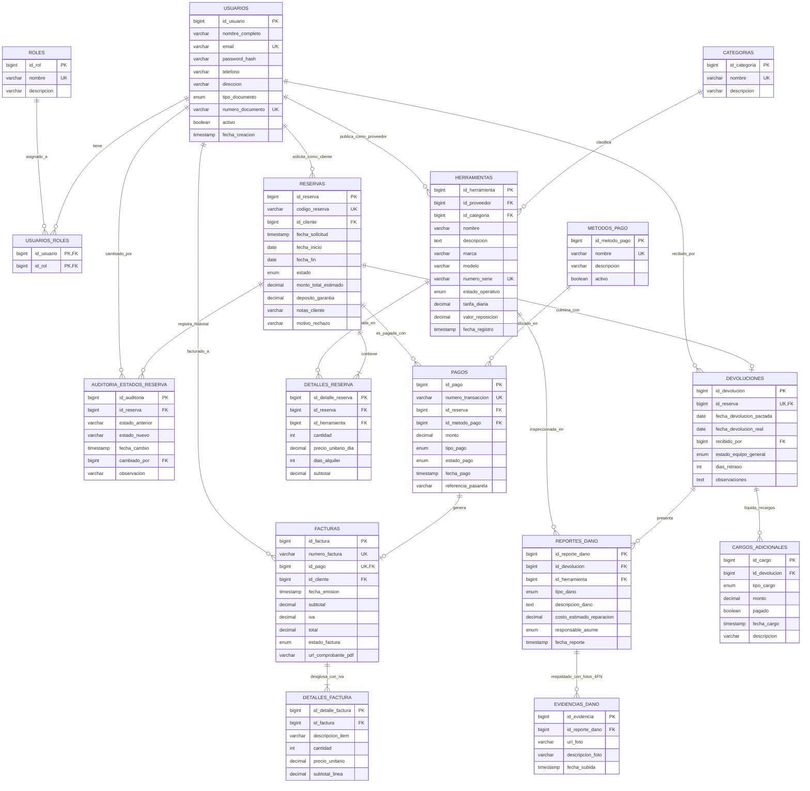

# 🗺️ Diagrama Entidad-Relación (ERD) - Normalización en 4FN

## Plataforma de Renta de Herramientas y Equipos de Construcción

Este documento contiene el modelo relacional completo de la base de datos `renta_herramientas_db`, estructurado estrictamente en **Cuarta Forma Normal (4FN)**.

---

## 📊 Diagrama Entidad-Relación (Mermaid)

---

## 📌 Puntos Críticos de la Normalización 4FN

1. **`evidencias_dano`:**
   - Desacopla la lista multivaluada de fotografías de los atributos escalares del daño (`costo_estimado_reparacion`, `responsable_asume`). Esto evita que cada foto adicional obligue a duplicar los metadatos de la avería.
2. **`auditoria_estados_reserva`:**
   - Desacopla la línea temporal de cambios de estado del conjunto multivaluado de herramientas alquiladas (`detalles_reserva`).
3. **`detalles_factura`:**
   - Garantiza que cada línea de cobro se justifique individualmente, aplicando la base imponible y el 19% de IVA de manera verificable ante auditorías tributarias.
